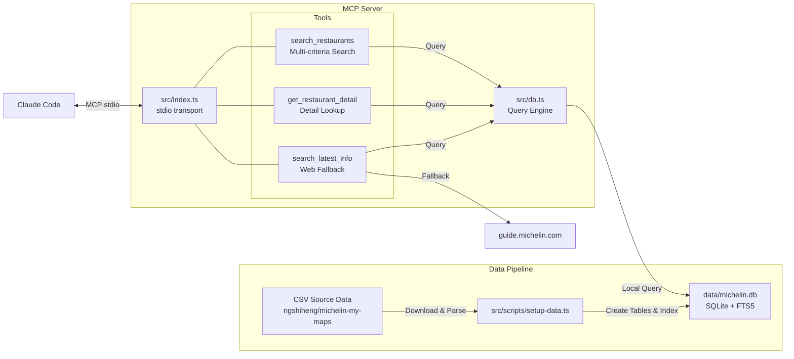

# MCP Michelin Guide Server

[](https://www.typescriptlang.org/)
[](https://modelcontextprotocol.io/)
[](https://www.sqlite.org/)
[](LICENSE)
[](https://github.com/ngshiheng/michelin-my-maps)

## About

An MCP (Model Context Protocol) server that lets you search Michelin Guide restaurants worldwide from Claude Code.

Powered by a local SQLite database with the FTS5 full-text search engine for fast, accurate queries -- with a web fallback to supplement the latest information from the official Michelin Guide site.

## Key Features

- **Multi-criteria restaurant search** -- Combine free-text search, city, country, cuisine type, award level, Green Star, and price level
- **Restaurant detail lookup** -- Get 17-field details by name (partial match) or Michelin Guide URL
- **Web fallback search** -- Fetches the latest info from the Michelin Guide website when local data is insufficient
- **~18,900 restaurants worldwide** -- Based on open-source data updated monthly
- **Local-first architecture** -- Fast search with SQLite + FTS5, no network required

## Architecture



## Prerequisites

| Item | Version | Note |
|------|---------|------|
| **Node.js** | >= 18 | LTS recommended |
| **npm** | >= 9 | Included with Node.js |
| **Claude Code** | Latest | MCP client |

## Installation

### 1. Clone the repository

```bash
git clone https://github.com/anhyobin/michelin-guide-mcp.git
cd michelin-guide-mcp
```

### 2. Install dependencies

```bash
npm install
```

### 3. Initialize the database

Downloads the CSV source data and creates the SQLite database.

```bash
npm run setup
```

This command will:
1. Download the latest CSV from the [ngshiheng/michelin-my-maps](https://github.com/ngshiheng/michelin-my-maps) repository
2. Parse the CSV and clean the data
3. Create `data/michelin.db` with the restaurants table + FTS5 virtual table

### 4. Build

```bash
npm run build
```

## Claude Code Integration

### Option 1: Using .mcp.json (Recommended)

Create or edit a `.mcp.json` file in your project root:

```json
{
  "mcpServers": {
    "michelin-guide": {
      "command": "node",
      "args": ["build/index.js"],
      "cwd": "/absolute/path/to/michelin-guide-mcp"
    }
  }
}
```

> Replace `cwd` with the absolute path to your cloned project directory.

### Option 2: Register via Claude Code CLI

```bash
claude mcp add michelin-guide -- node /absolute/path/to/michelin-guide-mcp/build/index.js
```

### Verify the integration

Ask Claude Code a question to confirm the MCP server is working:

```
Find 3-star Michelin restaurants in Tokyo
```

## MCP Tool API Reference

### 1. `search_restaurants` -- Multi-criteria restaurant search

Search restaurants by combining multiple criteria. Results are sorted by award level, returning 20 per page.

| Parameter | Type | Required | Description |
|-----------|------|----------|-------------|
| `query` | string | - | Free text search (FTS5 full-text search) |
| `city` | string | - | City name |
| `country` | string | - | Country name |
| `cuisine` | string | - | Cuisine type (e.g., Japanese, French, Italian) |
| `award` | string | - | Award level: `1 Star` \| `2 Stars` \| `3 Stars` \| `Bib Gourmand` \| `Selected Restaurants` |
| `green_star` | boolean | - | Whether the restaurant has a Michelin Green Star |
| `price_level` | number | - | Price level (1=budget to 4=luxury) |
| `page` | number | - | Page number (default: 1) |

**Example response:**

```json
{
  "total": 42,
  "page": 1,
  "totalPages": 3,
  "results": [
    {
      "name": "Sukiyabashi Jiro",
      "award": "3 Stars",
      "city": "Tokyo",
      "country": "Japan",
      "cuisine": "Sushi",
      "price_level": 4,
      "green_star": false,
      "url": "https://guide.michelin.com/..."
    }
  ]
}
```

### 2. `get_restaurant_detail` -- Restaurant detail lookup

Look up full details (17 fields) for a restaurant by name or Michelin Guide URL. Returns a candidate list when multiple matches are found.

| Parameter | Type | Required | Description |
|-----------|------|----------|-------------|
| `name` | string | Conditional | Restaurant name (partial match supported) |
| `url` | string | Conditional | Michelin Guide URL (exact match) |

Either `name` or `url` must be provided.

**Response fields:**

| Field | Description |
|-------|-------------|
| `name` | Restaurant name |
| `address` | Address |
| `location` | Location info (city, country) |
| `longitude` | Longitude |
| `latitude` | Latitude |
| `city` | City |
| `country` | Country |
| `price` | Price info (original) |
| `price_level` | Price level (1--4) |
| `cuisine` | Cuisine type |
| `award` | Award level |
| `green_star` | Green Star status |
| `url` | Michelin Guide URL |
| `description` | Description |
| `phone_number` | Phone number |
| `website_url` | Website |
| `facilities_and_services` | Facilities and services |

### 3. `search_latest_info` -- Web fallback search

Fetches the latest information from the Michelin Guide website when local database data is insufficient.

| Parameter | Type | Required | Description |
|-----------|------|----------|-------------|
| `restaurant_name` | string | Yes | Restaurant name |
| `location` | string | - | Location hint (city, country, etc.) |

## Usage Examples

Ask Claude Code in natural language and the MCP tools are called automatically.

### Restaurant search

```
Find Michelin-starred restaurants in Seoul
```
-> `search_restaurants`: `{ "city": "Seoul" }`

```
Which 3-star French restaurants in France also have a Green Star?
```
-> `search_restaurants`: `{ "country": "France", "cuisine": "French", "award": "3 Stars", "green_star": true }`

```
Find affordable Bib Gourmand Italian restaurants
```
-> `search_restaurants`: `{ "cuisine": "Italian", "award": "Bib Gourmand" }`

### Detail lookup

```
Tell me about Sukiyabashi Jiro
```
-> `get_restaurant_detail`: `{ "name": "Sukiyabashi Jiro" }`

```
Show me this restaurant's info: https://guide.michelin.com/...
```
-> `get_restaurant_detail`: `{ "url": "https://guide.michelin.com/..." }`

### Latest info

```
Get the latest info for a restaurant in Ginza, Tokyo
```
-> `search_latest_info`: `{ "restaurant_name": "...", "location": "Tokyo Ginza" }`

## Updating Data

The source data is updated monthly from [ngshiheng/michelin-my-maps](https://github.com/ngshiheng/michelin-my-maps). To refresh:

```bash
# Remove existing database and recreate
rm -rf data/
npm run setup
```

## Project Structure

```
michelin-guide-mcp/
├── .mcp.json                     # Claude Code MCP server config
├── package.json                  # Project metadata and dependencies
├── tsconfig.json                 # TypeScript configuration
├── .gitignore
├── data/
│   └── michelin.db               # SQLite DB (gitignored, generated)
├── src/
│   ├── index.ts                  # MCP server entry point (stdio)
│   ├── db.ts                     # DB initialization and queries
│   ├── types.ts                  # Type definitions
│   ├── utils.ts                  # Utility functions
│   ├── scripts/
│   │   └── setup-data.ts         # CSV download -> SQLite DB setup
│   └── tools/
│       ├── search-restaurants.ts # Multi-criteria search tool
│       ├── get-restaurant-detail.ts # Detail lookup tool
│       └── search-web.ts         # Web fallback search tool
└── build/                        # Compiled JavaScript output
```

## Tech Stack

| Technology | Purpose |
|------------|---------|
| **TypeScript 5.8** | Type-safe server development |
| **@modelcontextprotocol/sdk** | MCP server framework |
| **better-sqlite3** | High-performance native SQLite bindings |
| **SQLite FTS5** | Full-text search engine |
| **csv-parse** | CSV data parsing |
| **Zod** | Runtime schema validation |

## License

This project is distributed under the [MIT License](LICENSE).

## Credits

- **Restaurant data**: [ngshiheng/michelin-my-maps](https://github.com/ngshiheng/michelin-my-maps) (MIT License)
  - Open-source project providing data on ~18,900 Michelin Guide restaurants worldwide
  - Automatically updated monthly for the latest data
- **MCP Protocol**: [Model Context Protocol](https://modelcontextprotocol.io/) by Anthropic
